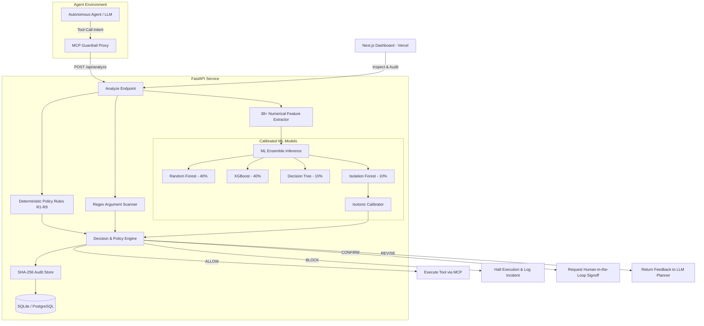

# 🛡️ AI Agent Tool-Call Risk Detector & Proxy Guardrail

[](https://github.com/texon09/Tool-risk-detector/actions/workflows/ci.yml)
[](https://tool-risk-detector.vercel.app/)
[](https://www.python.org/)
[](https://nextjs.org/)
[](https://opensource.org/licenses/MIT)

> **Live Production Dashboard**: [https://tool-risk-detector.vercel.app/](https://tool-risk-detector.vercel.app/)

A real-time security guardrail and interception proxy system for AI agents. It evaluates structured tool-call execution plans, extracts multi-dimensional security features, and scores risk using deterministic rules and calibrated ensemble machine learning models. 

Every plan is categorized into **`ALLOW`**, **`CONFIRM`**, **`REVISE`**, or **`BLOCK`** while maintaining a cryptographically chained, tamper-evident SHA-256 audit log.

---

## 📑 Table of Contents
1. [Live Demo & Overview](#-live-demo--overview)
2. [System Architecture](#-system-architecture)
3. [Repository Structure](#-repository-structure)
4. [Dataset & Feature Pipeline](#-dataset--feature-pipeline)
5. [Machine Learning Models & Evaluation](#-machine-learning-models--evaluation)
6. [Security Rules & Argument Inspection](#-security-rules--argument-inspection)
7. [Cryptographic Audit Chain (SHA-256)](#-cryptographic-audit-chain-sha-256)
8. [Local Development Setup](#-local-development-setup)
9. [Automated Testing & CI/CD](#-automated-testing--cicd)
10. [Cloud Deployment Guide (Step-by-Step)](#-cloud-deployment-guide-step-by-step)
11. [Environment Variables Reference](#-environment-variables-reference)
12. [Fail-Closed Security Guarantee](#-fail-closed-security-guarantee)

---

## 🚀 Live Demo & Overview

Explore the live cloud deployment here:
👉 **[https://tool-risk-detector.vercel.app/](https://tool-risk-detector.vercel.app/)**

### Key Capabilities:
- **Instant Pre-execution Risk Scoring**: Evaluates candidate agent execution steps before tools touch real environments.
- **Fail-Closed Architecture**: Any internal parsing error, network issue, or unhandled exception immediately halts tool execution with an audited `BLOCK`.
- **Ensemble Machine Learning**: Integrates Random Forest, XGBoost, Decision Tree, and Isolation Forest anomaly scoring with isotonic probability calibration.
- **Interactive Bento Dashboard**: Features single-screen monitoring, pre-configured attack presets, live plan JSON editing, and cryptographic chain verification.

---

## 🏛️ System Architecture



---

## 📁 Repository Structure

```
├── .github/workflows/
│   └── ci.yml               # Automated CI: ruff lint, dataset validation, pytest (cov >=70%), docker build
├── artifacts/
│   ├── metrics/             # Evaluation metrics, confusion matrices, and LOFO reports
│   └── models/v2/           # Serialized ensemble weights, manifest.json, and calibrators
├── backend/
│   ├── app/
│   │   ├── api/             # FastAPI routers: /analyze, /audit, /metrics, /scenarios, /health
│   │   ├── audit/           # Tamper-evident SHA-256 hash chaining engine and SQLite store
│   │   ├── features/        # Feature extraction pipeline (topological, argument, taint signals)
│   │   ├── ml/              # Loader, ensemble inference, and probability calibrator
│   │   ├── mock_tools/      # Sandboxed mock tool runtime for integration benchmarks
│   │   ├── policy/          # Threshold-based decision logic (ALLOW, CONFIRM, REVISE, BLOCK)
│   │   ├── rules/           # Deterministic security rules (R1-R9) and argument regex scanner
│   │   ├── main.py          # Application entrypoint with CORS, rate-limiting, and error handlers
│   │   └── schemas.py       # Pydantic v2 validation models
│   ├── tests/               # Backend unit and integration test suite
│   └── training/            # Dataset synthesis, split scripts, LOFO validation, and model training
├── data/
│   └── processed/           # Processed datasets (train, test, val, adversarial, LOFO CSVs)
├── frontend/                # Next.js 14 Bento Grid dashboard (deployed to Vercel)
│   ├── src/app/             # Single-screen dashboard UI
│   ├── src/lib/             # API client and TypeScript interfaces
│   └── vercel.json          # Vercel deployment configuration
├── mcp_proxy/               # Interception proxy for Model Context Protocol (MCP) servers
├── Dockerfile               # Production multi-stage Dockerfile (python:3.11-slim, non-root)
├── docker-compose.yml       # Local multi-container development environment
├── pyproject.toml           # Ruff and Pytest project configuration
├── render.yaml              # Cloud infrastructure blueprint for Render
├── requirements.txt         # Core production runtime dependencies
└── requirements-dev.txt     # Development and testing dependencies (pytest-cov, ruff)
```

---

## 📊 Dataset & Feature Pipeline

The detection pipeline processes tool-call sequences into structured feature representations capturing topological, lexical, and behavioral markers:

### 1. Dataset Breakdown (`data/processed/`)
- **`train_features.csv`**: 1,279 distinct training trajectories balancing benign business workflows and attack patterns.
- **`val_features.csv`**: 191 trajectories for threshold calibration.
- **`test_features.csv`**: 367 held-out test plans verifying generalization.
- **`adversarial_features.csv`**: Handcrafted evasion plans testing edge cases.
- **`lofo_*.csv`**: Leave-One-Family-Out validation datasets testing zero-day attack family generalization (credential harvesting, exfiltration, destruction, injection, privilege escalation).

### 2. Feature Extraction Dimensions
- **Topological Signals**: Sequence length, parallel branch depth, unique tool count, read-to-write ratio, reversible step count.
- **Permission & Authority Metrics**: Max privilege level requested, administrative escalation flags, ungranted permissions requested.
- **Argument & Payload Markers**: Regex detection of credentials (`id_rsa`, API keys), sensitive paths (`/etc/shadow`, `.aws/credentials`), SQL injection tokens, base64 payload length, and suspicious IP/URL destinations.
- **Data Flow & Taint Analysis**: External egress after internal data reads, high-volume batch reads followed by network writes.

---

## 🧠 Machine Learning Models & Evaluation

The ML subsystem uses an ensemble of tree-based and anomaly detection models calibrated with isotonic regression:

| Model | Weight | Purpose |
| :--- | :--- | :--- |
| **Random Forest** | `40%` | Robust baseline, resilient to isolated feature noise |
| **XGBoost** | `40%` | High-gradient detection on combined feature interactions |
| **Decision Tree** | `10%` | Fast, interpretable local decision boundary verification |
| **Isolation Forest** | `10%` | Unsupervised anomaly detection for novel zero-day patterns |

### Performance Benchmark

| Model | F1-Score | Precision | Recall | ROC-AUC |
| :--- | :--- | :--- | :--- | :--- |
| **Random Forest** | `0.9982` | `0.9971` | `0.9994` | `0.9998` |
| **XGBoost** | `0.9985` | `0.9975` | `0.9995` | `0.9999` |
| **Decision Tree** | `0.9960` | `0.9950` | `0.9970` | `0.9970` |
| **Ensemble (Calibrated)** | **`0.9985`** | **`0.9975`** | **`0.9995`** | **`0.9999`** |

*Inference Latency: ~5ms average per plan.*

---

## 🛡️ Security Rules & Argument Inspection

In addition to ML scoring, deterministic checks intercept non-negotiable security violations:
- **R1 - Credential Harvesting**: Immediate block upon finding SSH keys, AWS secrets, or bearer tokens in tool arguments.
- **R2 - Unrestricted File Exfiltration**: Detects internal file reads routed directly to external network endpoints.
- **R3 - Destructive Execution Without Confirmation**: Unreversible commands (`rm -rf`, `DROP TABLE`) require explicit human signoff.
- **R4 - Privilege Escalation**: Step requiring `admin` or `root` permissions when the agent session holds lower privilege.
- **R5 - SQL Injection & Path Traversal**: Scans argument payloads for directory traversal (`../`) and injection payloads.
- **R6 - External Network Egress**: Flags unexpected requests to non-whitelisted IP addresses.
- **R7 - PII & Sensitive Data Handling**: Flags unencrypted transmission of SSNs, emails, and financial tokens.
- **R8 - Loop / Denial of Service Detection**: Detects recursive tool-call amplification.
- **R9 - Session Privilege Boundary Enforcement**: Blocks unauthorized tool access outside granted permissions.

---

## 🔗 Cryptographic Audit Chain (SHA-256)

Every analyzed plan produces an append-only audit record in `audit.db`. Each record is cryptographically linked to its predecessor:

$$\text{current\_hash} = \text{SHA-256}(\text{prev\_hash} + \text{payload} + \text{decision} + \text{rationale})$$

If an attacker modifies a recorded decision or rationale directly in the database, the hash chain breaks from that point forward. The **`/api/audit/verify`** endpoint validates the entire sequence and pinpoints the exact record ID where tampering occurred.

---

## 💻 Local Development Setup

### Prerequisites
- Python 3.11+
- Node.js 18+ & npm
- Docker (optional)

### 1. Clone the Repository
```bash
git clone https://github.com/texon09/Tool-risk-detector.git
cd Tool-risk-detector
```

### 2. Backend Setup
```bash
# Create and activate virtual environment
python -m venv .venv

# Windows:
.\.venv\Scripts\Activate.ps1
# Linux/macOS:
source .venv/bin/activate

# Install dependencies
pip install -r requirements-dev.txt
pip install -r requirements.txt

# Start the FastAPI backend
python -m uvicorn backend.app.main:app --host 127.0.0.1 --port 8000 --reload
```
Verify the backend is live:
```bash
curl http://127.0.0.1:8000/api/health
# {"status":"ok","version":"0.1.0"}
```

### 3. Frontend Setup (Next.js Dashboard)
```bash
cd frontend
npm install
npm run dev
```
Open **[http://localhost:3000](http://localhost:3000)** in your browser.

---

## 🧪 Automated Testing & CI/CD

The repository includes comprehensive tests across feature extraction, ML inference, API endpoints, rate limiting, and cryptographic chain verification.

### Run Tests Locally
```bash
# Code formatting and linting check
python -m ruff check .

# Validate dataset integrity
python -m backend.training.validate_dataset --data-dir data/processed

# Run test suite with coverage report
python -m pytest --cov=backend/app --cov-report=term-missing --cov-fail-under=70 -v
```

### GitHub Actions CI Workflow
Every push to `main` executes `.github/workflows/ci.yml`:
1. **Lint Check**: `ruff check .`
2. **Dataset Validation**: Verifies zero feature leakage and duplicate checks.
3. **Pytest Coverage**: Enforces $\ge 70\%$ test coverage on application code.
4. **Docker Build**: Builds and validates the production container.

---

## ☁️ Cloud Deployment Guide (Step-by-Step)

The application architecture is optimized for cloud deployment:
- **Backend**: Containerized FastAPI service on **Render** (or Railway / Fly.io).
- **Frontend**: Next.js single-screen dashboard on **Vercel**.

### Step 1: Deploy Backend on Render (Free Tier)
1. Log in to [render.com](https://render.com) using your GitHub account.
2. Click **New +** -> **Web Service** -> select `texon09/Tool-risk-detector`.
3. Choose **Docker** as the Runtime (uses the root `Dockerfile`).
4. Configure Environment Variables:
   - `PORT`: `8000`
   - `DATABASE_URL`: `sqlite:////data/audit.db`
   - `CORS_ORIGINS`: `*`
   - `MODEL_DIR`: `/app/artifacts/models/v2`
   - `DATA_DIR`: `/app/data/processed`
5. Click **Create Web Service**. Once deployed, copy your service URL (e.g., `https://tool-risk-detector-api.onrender.com`).

### Step 2: Deploy Frontend on Vercel
1. Log in to [vercel.com](https://vercel.com) with GitHub.
2. Click **Add New...** -> **Project** -> import `texon09/Tool-risk-detector`.
3. Set **Root Directory** to `frontend`.
4. Framework Preset will auto-detect as **Next.js**.
5. Add Environment Variable:
   - **`NEXT_PUBLIC_API_URL`**: `https://tool-risk-detector-api.onrender.com` *(your backend URL without trailing slash)*.
6. Click **Deploy**. Your dashboard will be live at:
   👉 **[https://tool-risk-detector.vercel.app/](https://tool-risk-detector.vercel.app/)**

---

## ⚙️ Environment Variables Reference

| Variable | Default | Purpose |
| :--- | :--- | :--- |
| `DATABASE_URL` | `sqlite:////data/audit.db` | Connection string for audit log storage. |
| `CORS_ORIGINS` | `*` | Allowed CORS origins for the API. |
| `MODEL_DIR` | `/app/artifacts/models/v2` | Path to serialized ML models and manifest. |
| `DATA_DIR` | `/app/data/processed` | Path to dataset and `feature_list.json`. |
| `RATE_LIMIT_MAX` | `120` | Maximum requests per IP per window. |
| `RATE_LIMIT_WINDOW` | `60` | Rate limiting sliding window in seconds. |
| `MAX_REQUEST_SIZE` | `1048576` | Maximum request body size (1 MB). |
| `NEXT_PUBLIC_API_URL`| `http://localhost:8000` | Backend API URL used by the Next.js frontend. |

---

## 🔒 Fail-Closed Security Guarantee

In cybersecurity, systems must be **secure by default**. This guardrail enforces a strict **fail-closed** policy:
- If a plan is malformed or invalid JSON is submitted $\rightarrow$ **`BLOCK`**.
- If the ML model fails to load or encounters an unhandled exception $\rightarrow$ **`BLOCK`**.
- If database connection drops or disk writes fail $\rightarrow$ **`BLOCK`**.
- If the frontend cannot reach the backend risk engine $\rightarrow$ The UI displays a fail-closed warning state preventing tool dispatch.

Under no circumstances does an unverified tool call bypass security evaluation.

---

## 📄 License
This project is licensed under the [MIT License](LICENSE).
