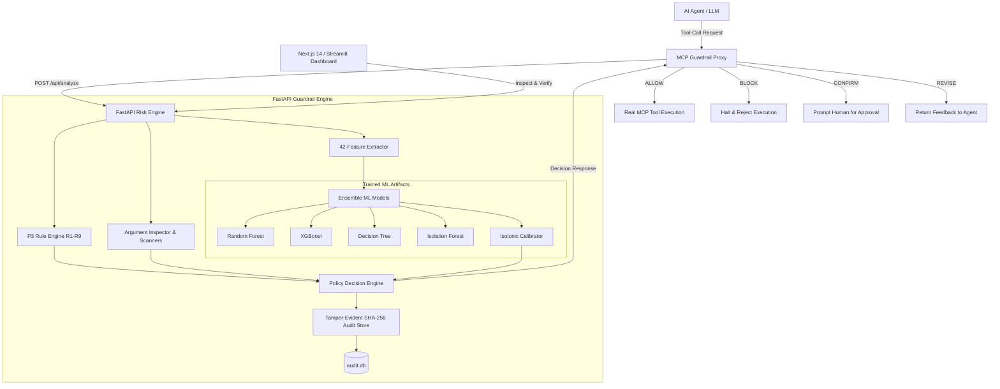

# AI Agent Tool-Call Risk Detector & Proxy Guardrail

A proxy-style security guardrail system for AI agents that intercepts tool-call execution plans in real time, extracts structural and payload security signals, and evaluates risk using deterministic rules and calibrated ensemble machine learning models. The system classifies incoming plans into **`ALLOW`**, **`CONFIRM`**, **`REVISE`**, or **`BLOCK`** while maintaining an immutable, tamper-evident SHA-256 cryptographic audit chain.

---

## 🏛️ System Architecture



---

## 📁 Project Structure

```
├── artifacts/
│   ├── models/v2/          # Serialized .joblib models & manifest.json
│   ├── metrics/            # results.json per-model benchmark metrics
│   └── figures/            # Evaluation visualizations
├── backend/
│   ├── app/
│   │   ├── api/            # Endpoints: analyze, audit, health, metrics, scenarios
│   │   ├── audit/          # Tamper-evident SHA-256 hash chain & SQLite store
│   │   ├── features/       # 42-feature extraction from plan structures
│   │   ├── ml/             # Model loading, ensemble inference, calibration
│   │   ├── mock_tools/     # Safe sandboxed tool execution handlers
│   │   ├── policy/         # Decision engine (ALLOW, CONFIRM, REVISE, BLOCK)
│   │   ├── rules/          # Rule engine (R1-R9) and argument regex inspector
│   │   ├── main.py         # FastAPI application with production hardening
│   │   └── schemas.py      # Strict Pydantic v2 schemas
│   ├── training/           # Dataset generation, validation, and training
│   ├── tests/              # 68+ unit and integration tests
│   ├── Dockerfile          # Production containerfile (python:3.11-slim, non-root)
│   └── openapi.yaml        # Complete OpenAPI 3.1.0 specification
├── data/
│   └── processed/          # Benchmark dataset CSVs and feature_list.json
├── frontend/               # Next.js 14 Dashboard + Streamlit app
│   ├── src/app/            # Live Monitor (/), Metrics (/metrics), Audit (/audit)
│   ├── api_client.py       # Python API client
│   └── app.py              # Companion Streamlit application
├── mcp_proxy/              # Interception proxy guardrail & mock MCP servers
├── scripts/                # Automated verification and demo scripts
└── .github/workflows/      # CI/CD pipeline (lint, coverage >=70%, docker build)
```

---

## ⚡ Quickstart (Local Development)

### 1. Environment Setup

```powershell
# Create and activate virtual environment
python -m venv .venv
.\.venv\Scripts\Activate.ps1

# Install development dependencies
pip install -r requirements-dev.txt
pip install -r requirements.txt
```

### 2. Run the Backend API

```powershell
# Start FastAPI backend with automatic reloading on port 8000
python -m uvicorn backend.app.main:app --host 127.0.0.1 --port 8000 --reload
```
Test that the health endpoint responds:
```powershell
curl http://127.0.0.1:8000/api/health
# Returns: {"status":"ok","version":"0.1.0"}
```

### 3. Run the Frontend Dashboard

You can run either the **Next.js 14 Dashboard** or the **Streamlit Dashboard**:

#### Option A: Next.js 14 Dashboard (Recommended)
```powershell
cd frontend
npm install
npm run dev
# Dashboard opens at: http://localhost:3000
```

#### Option B: Streamlit Dashboard
```powershell
python -m streamlit run frontend/app.py
# Dashboard opens at: http://localhost:8501
```

---

## 🤖 MCP Proxy Guardrail Setup

The MCP Proxy intercepts AI agent tool-call intents before they hit external services, evaluates them against `/api/analyze`, and enforces guardrail policies:

- **`ALLOW`**: Dispatches the tool call to the destination service and returns results.
- **`BLOCK`**: Refuses execution immediately and returns a security error.
- **`CONFIRM`**: Halts execution and requires human approval before proceeding.
- **`REVISE`**: Returns plan back to the agent with remediation feedback.

### Run MCP Proxy Tests:
```powershell
python mcp_proxy/test_proxy.py
```

---

## 🧠 ML Training & Validation Pipeline

The model pipeline uses a canonical 42-feature schema extracted from tool-call parameters, sequence topology, and payload markers:

```powershell
# 1. Validate processed datasets against strict schema requirements
python -m backend.training.validate_dataset --data-dir data/processed

# 2. Train models with tie-aware thresholds (outputs artifacts to artifacts/models/v2)
python -m backend.training.train --data-dir data/processed --out-dir artifacts/models --metrics-dir artifacts/metrics --version v2 --seeds 42 43 44 45 46

# 3. Generate benchmark metrics report for /api/metrics
python -m backend.training.generate_metrics_report
```

---

## 🧪 Automated Testing & CI/CD

Run the comprehensive test suite (68+ tests covering security rules, ML inference, API endpoints, rate limiting, and audit chain verification):

```powershell
# Run all backend tests
python -m pytest backend/tests -v

# Run root evaluation and data tests
python -m pytest tests -v

# Run with test coverage
python -m pytest --cov=backend --cov-report=term-missing
```

### GitHub Actions CI
The CI workflow defined in `.github/workflows/ci.yml` triggers on pushes to `main`, `backend-and-security`, and `feature/model-training`. It runs formatting, data validation, pytest with a 70% coverage threshold, and validates the Docker build.

---

## 🐳 Docker Containerization

Run the entire stack with Docker Compose:

```powershell
# Build and start both API and Streamlit UI with persistent SQLite volume
docker compose up --build

# Stop the services
docker compose down
```

---

## 🌐 Production Cloud Deployment Guide

### Deploying Backend (Render or Fly.io)
1. **Render Deployment**:
   - Create a new **Web Service** connected to your repository.
   - Environment: `Docker` (Dockerfile Path: `backend/Dockerfile` or `Dockerfile`).
   - Add a persistent disk mounted at `/data` for SQLite persistence.
   - Configure Environment Variables:
     - `DATABASE_URL=sqlite:////data/audit.db`
     - `CORS_ORIGINS=https://your-frontend.vercel.app`
     - `TAU_MEDIUM=0.2`
     - `TAU_HIGH=0.5`
     - `TAU_CONFIRM=0.7`
     - `TAU_BLOCK=0.85`
2. **Fly.io Deployment**:
   ```bash
   fly launch
   fly volumes create audit_data --size 1
   fly deploy
   ```

### Deploying Frontend (Vercel)
1. Import repository on [Vercel](https://vercel.com).
2. Set Root Directory to `frontend`.
3. Add Environment Variable:
   - `NEXT_PUBLIC_API_URL=https://your-backend.onrender.com`
4. Deploy!

### Uptime Monitoring
Set up an external health check (e.g. UptimeRobot or BetterStack) pinging `GET /api/health` every 5 minutes to keep serverless instances warm and verify service availability.

---

## ⚙️ Environment Variables Reference

| Variable | Default | Description |
|---|---|---|
| `DATABASE_URL` | `sqlite:///audit.db` | SQLite connection string for audit log storage. |
| `CORS_ORIGINS` | `*` | Comma-separated list of allowed CORS origins. |
| `RATE_LIMIT_MAX` | `120` | Max allowed requests per client IP within window. |
| `RATE_LIMIT_WINDOW`| `60` | Rate limiting sliding window in seconds. |
| `MAX_REQUEST_SIZE`| `1048576` | Maximum request body size in bytes (1MB). |
| `MODEL_DIR` | `artifacts/models/v2` | Directory containing serialized ML models and manifest. |
| `DATA_DIR` | `data/processed` | Directory containing training data and `feature_list.json`. |
| `NEXT_PUBLIC_API_URL`| `http://localhost:8000` | Backend API URL used by the Next.js frontend. |

---

## 🛡️ Security & Fail-Closed Guarantee

In accordance with strict zero-trust principles:
- **Fail-Closed by Design**: If any unhandled exception occurs in model prediction, feature extraction, or rule evaluation, the engine automatically catches the error, logs it with a fail-closed emergency audit hash, and returns an audited **`BLOCK`** with `critical_violations=1`.
- **Tamper-Evident Auditing**: Every decision is linked via SHA-256 hash to the preceding decision (`current_hash = SHA256(prev_hash + payload + decision + rationale)`). Any alteration of prior logs is detected by `/api/audit/verify`.
